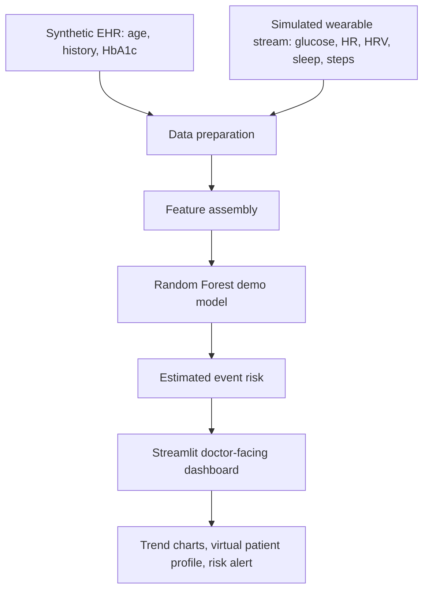

# HealthTwin AI Architecture

Paste the Mermaid diagram below into a Mermaid-compatible editor and export it as PDF or include it in your presentation.

All data is synthetic. The model is a demonstrator and is not clinically validated.
