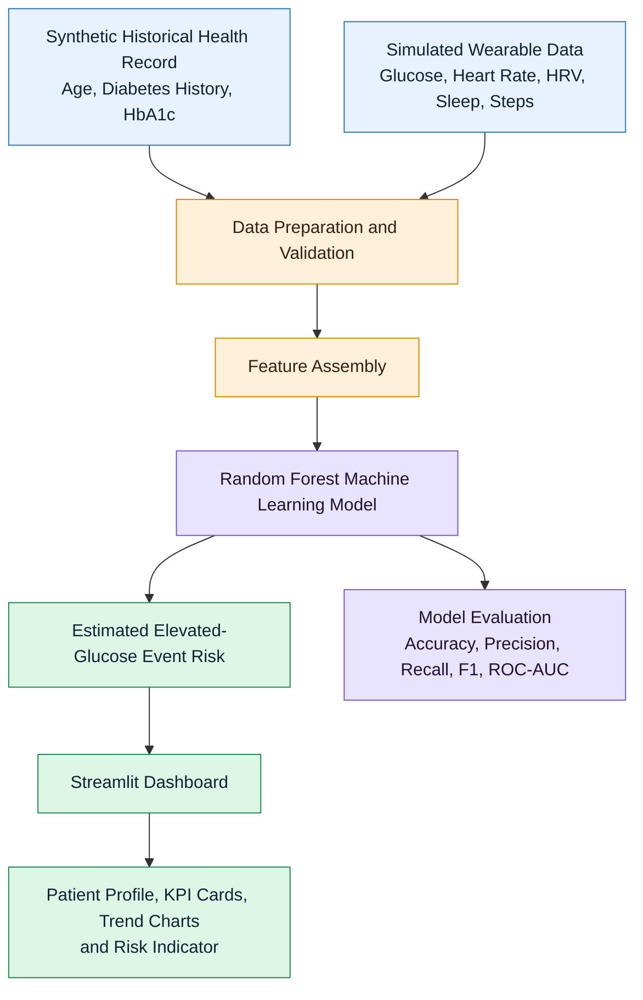

# HealthTwin AI — System Architecture

## 1. Architecture Overview

## 2. Main Components

- **Synthetic health record:** Contains historical patient attributes.
- **Wearable data simulator:** Generates sample readings for the dashboard.
- **Data preparation:** Organizes the inputs for model prediction.
- **Feature assembly:** Combines the relevant model inputs.
- **Machine learning model:** Uses a Random Forest classifier to estimate event risk.
- **Streamlit dashboard:** Displays patient information, trends, and the estimated risk.
- **Model evaluation:** Reports performance on a held-out synthetic test set.

## 3. Data Flow

Historical record + simulated wearable readings → Data preparation → Feature assembly → Random Forest model → Risk estimate → Streamlit dashboard.

## 4. Limitations and Safety

This project is an educational proof of concept. All patient records and wearable readings are synthetic. The model has not been clinically validated and must not be used for medical diagnosis, treatment, or real-world clinical decisions.
